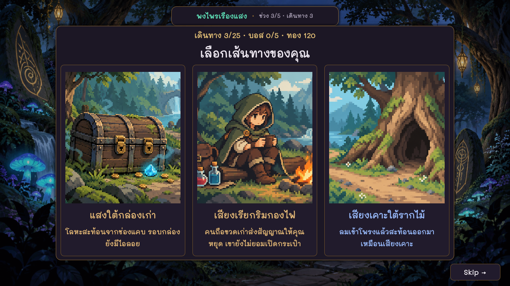
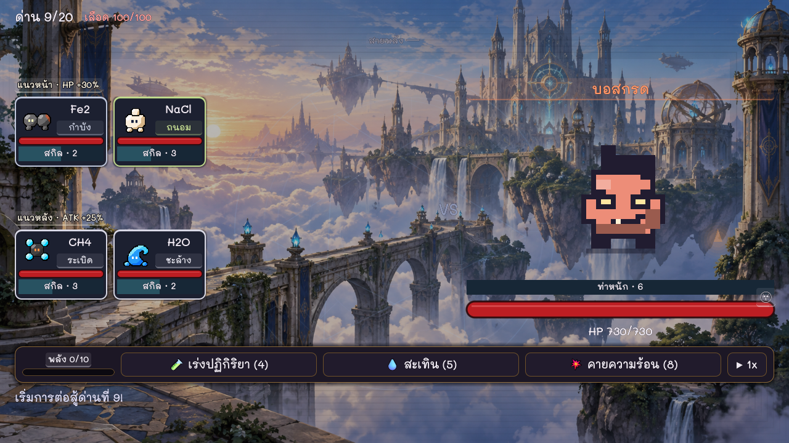

# Ultimate Chem Battle

เกมวางแผน 2D ที่ให้ผู้เล่นซื้อธาตุ ผสมเป็นสารประกอบ แล้วจัดทีมออกเดินทาง ตัวอย่างเช่น ใช้ H สองอะตอมกับ O หนึ่งอะตอมเพื่อสร้างน้ำ (H₂O) ในเกม ระหว่างทางผู้เล่นเลือกเหตุการณ์ ตัดสินใจว่าจะเสี่ยงหรือถอย และเตรียมทีมรับมือบอส

[เล่นบนเว็บ](https://ultimate-chem-battle-playtest.techinforwork12.chatgpt.site/?release=x8-skip-v8)

## เปิดโปรเจกต์

เปิด Godot 4.7.2 เลือก Import แล้วเปิดไฟล์ [project.godot](project.godot) กด F6 เพื่อทดสอบฉากที่เปิดอยู่ หรือ F5 เพื่อเล่นตั้งแต่หน้าแรก

## ดูซอร์สโค้ด

- [หน้าจัดทีม ร้านค้า และการผสมสาร](scripts/main.gd)
- [เหตุการณ์ระหว่างเดินทาง](scripts/event.gd)
- [ระบบต่อสู้](scripts/battle.gd)
- [ข้อมูลที่ใช้ร่วมกันระหว่างฉาก](scripts/game_state.gd)
